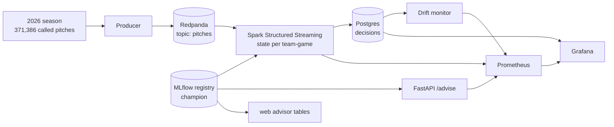

# ABS challenge advisor

Challenge or hold? For any MLB automated ball–strike (ABS) situation, this gives
the optimal decision from a model solved on every 2026 regular-season pitch, and
runs that model live over a replayed season.

- **Advisor** (`web/`): the in-browser tool at [abs.poshakpathak.com](https://abs.poshakpathak.com).
- **Streaming pipeline**: the 2026 season replayed through Redpanda (Kafka API);
  Spark Structured Streaming keeps each team's challenge state and scores every
  called pitch as it arrives.
- **Model service**: FastAPI over the same model, versioned and gated in MLflow,
  with Prometheus metrics, drift and calibration monitoring, and a Grafana dashboard.
- **CI/CD**: GitHub Actions runs the unit tests, trains and registers a model,
  runs the whole stack end to end, and publishes the API image to GHCR.

The model comes from my paper, *Spending a Scarce Option Under Perceptual Noise:
Optimal Challenge Policy for MLB's 2026 Automated Ball–Strike System*.



## The decision

A team holds a few challenges; it keeps one it wins and loses one it doesn't.
The paper proves the optimal rule is a cutoff:

> challenge if and only if `p · g > (1 − p) · λ`

- `p`: probability the call is wrong, given how far past the zone edge the player
  saw the ball and how noisy his view is (a Bayesian posterior over the 2026
  distribution of umpire misses);
- `g`: the win probability the call is worth, from a win-expectancy model;
- `λ`: the shadow price of a challenge, the win probability a team expects to
  lose later by spending one now, from a Markov decision process solved by
  backward induction over inning, outs, score margin and challenges held.

`abslive/policy.py` is that rule in plain numpy. The stream, the API, the batch
replay and the web advisor's tables all go through it.

## Fidelity to the paper

| Check | Result |
| --- | --- |
| Shadow prices vs the paper's table | max difference 1e-16 |
| Stake table vs every called pitch it covers (350,635) | identical |
| Season replay under the optimal policy, same random draws as the paper | agrees to 7e-6 wins |
| League wins captured, optimal policy (paper: 140.2) | 140.1 ± 0.2 |
| League wins captured by players (paper: 104.2) | 104.2 |
| `web/advisor_data.js` regenerated from the model | byte-identical to the published file |
| Streamed decisions vs the batch replay, row by row (CI) | exact |

The first three are checked when the model is exported from the research code
(`export/export_from_absgto.py`); the rest by the tests.

## Run it

Needs Docker.

```sh
make up        # Redpanda, Postgres, MLflow; trains a champion; starts the stream, API, monitor, Grafana
make replay    # streams July–September 2026 at 300 pitches a second
```

- Grafana: http://localhost:3000 (dashboard *ABS challenges, live*)
- API: http://localhost:8000/docs
- MLflow: http://localhost:5000
- Prometheus: http://localhost:9090

```sh
curl -s localhost:8000/advise -H 'Content-Type: application/json' -d '{
  "inning": 7, "half": "bottom", "outs": 1, "balls": 2, "strikes": 2, "on_second": true,
  "home_score": 2, "away_score": 3, "side": "batter", "challenges_left": 2, "perceived_miss_in": -1.5}'
```

```json
{"recommendation": "challenge", "p_call_wrong": 0.1097, "breakeven_confidence": 0.0725,
 "stake_wp": 0.07888, "shadow_price_wp": 0.00617, "expected_gain_wp": 0.00316, "sigma_in": 2.665,
 "model_version": "abs-challenge-policy/v1"}
```

`make help` lists the rest. `make test` runs the unit tests without any services.

## How each piece works

### Streaming (`stream/`)

The producer replays a range of days, interleaving each day's games so a full
slate is in progress at once, and keys messages by game so a game's pitches stay
in order. Spark reads the topic, groups by team and game, and keeps the optimal
policy's state between micro-batches with `applyInPandasWithState`: challenges
held (one is lost only when a challenge fails) and the extra-inning bonus. The
player's perception is simulated with noise that depends only on the pitch, so a
restart or a different batching gives the same decisions. Writes to Postgres are
idempotent on the pitch key.

For each pitch the stream records what the optimal policy would do, what the
players actually did, and the value of each: win probability won back, and
Challenge Value Added (an overturn's stake minus the shadow price of a lost
challenge).

### Model registry and training (`abslive/train.py`)

The part of the model that can go stale is the distribution of umpire misses the
posterior is built on, so that is what training refits, on a window of dates. A
run then:

1. scores the new posterior on the pitches after the window: Brier score,
   expected calibration error, log loss (ABS gives the true call for every pitch);
2. replays those pitches under the optimal policy and compares the wins captured
   with the paper's model;
3. logs everything to MLflow and registers a version as `challenger`;
4. moves `champion` to it only if it passes the gates and is no worse than the
   current champion on the same pitches.

The shadow prices and stakes come from the paper's full-season solution and are
not re-solved here.

### Monitoring (`abslive/monitor.py`)

Every few seconds the monitor reads the latest 5,000 scored pitches and computes,
against the champion's training window, the population stability index of the
miss distance (by side) and of the stakes, and the calibration of the
`P(call is wrong)` the model gave. It exports them to Prometheus, keeps the
history in Postgres, and raises an alert above PSI 0.2 or ECE 0.02.

The real 2026 season barely drifts: month to month the PSI of the miss distance
stays below 0.001. To show the alert working, `make drift` replays a day with
every miss shifted by 3 inches; CI does the same and checks the alert fires.

### API (`service/app.py`)

`POST /advise`, `POST /advise/batch`, `GET /model`, `GET /health`, `GET /metrics`,
and `POST /reload` (token-protected) to pick up a newly promoted champion. It
serves the MLflow champion when `MODEL_URI` is set and the paper's tables in
`model/` otherwise, so the published image runs on its own:

```sh
docker run -p 8000:8000 ghcr.io/poshakpathak/abs-api:latest
```

## Data

`data/replay_2026.csv.gz` holds every 2026 regular-season called pitch with a
tracked location (371,386 pitches, 2,429 games), from public Statcast data, with
the miss distance, stakes and perception noise computed by the research code.
`model/` holds the solved tables. Both are written by
`export/export_from_absgto.py` from the research project.

## Repository

| Path | What |
| --- | --- |
| `abslive/` | the decision library, replay, training, monitor |
| `service/` | FastAPI app |
| `stream/` | Redpanda producer and Spark job |
| `web/` | the advisor |
| `infra/` | Postgres schema, Prometheus, Grafana |
| `model/`, `data/` | exported model and season |
| `export/` | export from the research project |
| `tests/` | unit and end-to-end tests |
